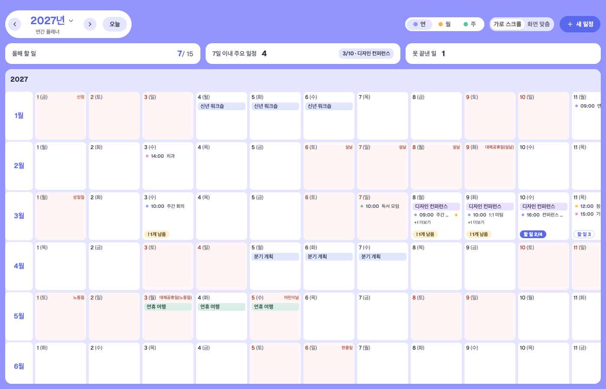
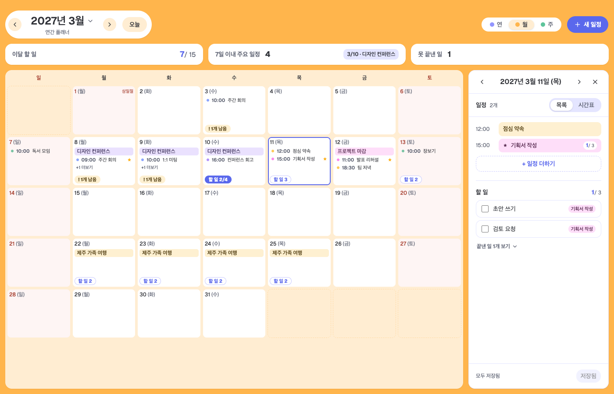
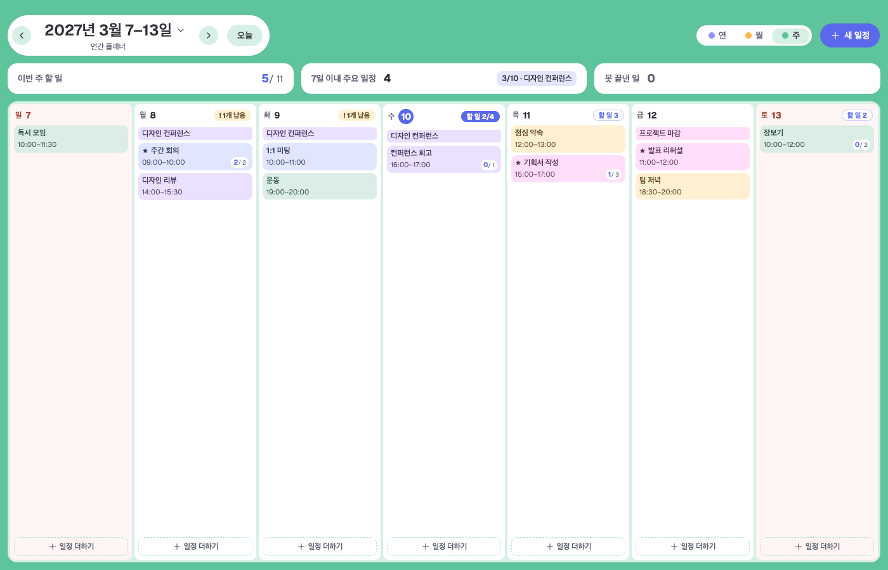
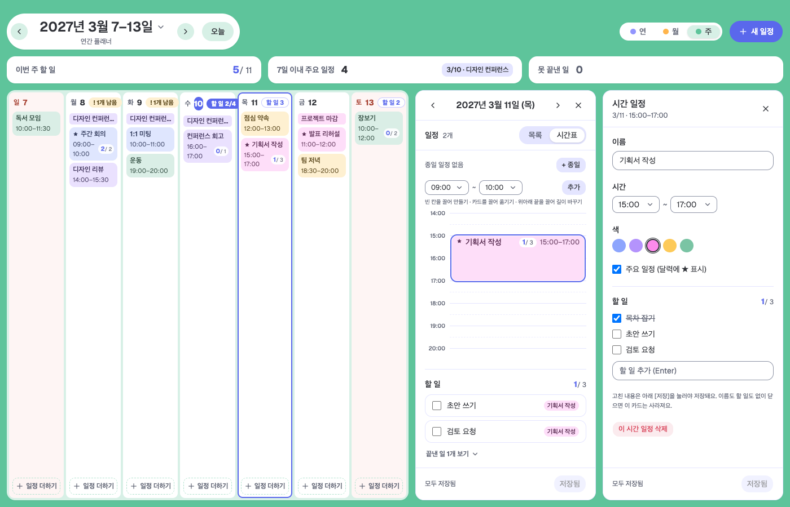

# my-planner

한 화면에서 일정을 **연 · 월 · 주** 세 가지 크기로 보는 **달력형 플래너**입니다.
날짜를 마우스로 끌어 기간 일정을 만들고, 날짜를 누르면 오른쪽 패널에서 그날의 일정·시간표·할 일을 다룹니다.
이메일과 비밀번호로 로그인하고, 일정은 [수파베이스(Supabase)](https://supabase.com)에 **계정마다 따로** 저장됩니다. 그래서 다른 컴퓨터나 브라우저에서도 로그인하면 같은 일정이 보입니다.

## 화면



<table>
  <tr>
    <td width="50%"></td>
    <td width="50%"></td>
  </tr>
  <tr>
    <td align="center">월 보기 + 일정 패널</td>
    <td align="center">주 보기 (보드형)</td>
  </tr>
  <tr>
    <td colspan="2"></td>
  </tr>
  <tr>
    <td colspan="2" align="center">일정 패널의 시간표 + 시간 일정 카드 상세 패널</td>
  </tr>
</table>

> 화면 속 일정은 모두 예시이고, "오늘"을 2027년 3월 10일로 맞춰 찍었습니다. 사진은 `docs/images/`에 있고, 화면 모양을 크게 바꾸면 예시 일정만 넣은 화면으로 다시 찍어 주세요.

## 주요 기능

### 보기

- **연 보기**: 고른 해와 다음 해를 이어서 보여 줍니다(파랑). 상단 바의 `가로 스크롤` / `화면 맞춤`으로 보는 방식을 고릅니다(연 보기에만 있음).
- **월 보기**: `월` 탭을 누르면 한 달이 일요일부터 시작하는 7칸 × 5~6주로 보입니다(앰버). 날짜 칸은 연 보기와 같은 부품이라 일정 막대·할 일 알약·누르기·끌기가 똑같이 됩니다.
- **주 보기 (보드형)**: `주` 탭을 누르면 일요일부터 토요일까지 요일마다 한 칸인 보드가 보입니다(민트). 칸마다 머리(요일·날짜, 오늘은 파랑 동그라미, 할 일 알약) 아래에 기간·종일 막대와 시간 일정 카드가 시작 시각 순서로 쌓입니다. 머리를 누르면 그날 패널, 막대·카드를 누르면 상세 패널이 열리고, 칸 맨 아래 `+ 일정 더하기`로 그날의 새 일정 패널(시간 일정)을 엽니다. 시각을 끌어 바꾸는 일은 일정 패널의 `시간표`에서 합니다.
- **보기를 바꿀 때**: 보는 해가 올해면 이번 달·이번 주를, 다른 해면 그 해 1월·첫 주를 보여 줍니다.

### 상단 바와 요약 줄

- **상단 바**: 왼쪽 흰 캡슐에 `‹ 기간 ›`과 `오늘`, 오른쪽에 `[● 연 | ● 월 | ● 주]` 보기 탭(점 색 = 보기 색), (연 보기만) `가로 스크롤 / 화면 맞춤`, `새 일정` 버튼이 있습니다.
  - `‹ ›`는 보기에 따라 한 해 · 한 달 · 한 주씩 넘깁니다. 가운데 이름을 누르면 연도를 고릅니다(올해 기준 −1년 ~ +3년).
  - `오늘`은 올해·이번 달·이번 주로 돌아가 오늘의 일정 패널을 열고, 오늘 칸이 보이게 스크롤합니다.
  - `새 일정`은 열려 있는 날(없으면 오늘)의 새 일정 패널을 엽니다.
- **요약 줄**: 상단 바 아래 카드 세 장이 **저장된 일정 기준으로**, 지금 보는 범위(연 = 그 해, 월 = 그달, 주 = 그 주)를 셉니다. 범위 이름은 `올해`·`이달`·`이번 주`, 지금이 아니면 `2027년`·`3월`·`11/22–11/28`처럼 나옵니다.
  - **할 일**: 끝낸 수 / 전체 (`올해 할 일 3 / 7`)
  - **7일 이내 주요 일정**: 지금부터 7일 중 보는 범위 안의 날에 끝나는 기간·종일 일정과 ★ 시간 일정. 이미 지난 것은 빼고 가장 가까운 것을 함께 보여 줍니다. 지난 범위나 7일보다 먼 범위를 보면 0개입니다.
  - **못 끝낸 일**: 지난 날에 남은 할 일 수

### 패널

화면은 `[달력] [일정 패널] [두 번째 패널]`이 한 줄로 섭니다. 패널이 열려도 달력은 계속 보이고, 두 번째 패널은 한 번에 하나만 열립니다.

- **일정 패널**: 날짜 칸(빈 곳이나 날짜)을 누르면 오른쪽에 그날의 일정 패널이 열리고, 그 칸에 테두리가 생깁니다. `‹ ›`로 전날·다음 날로 넘어갑니다.
  - **일정** 구역: 제목 줄 오른쪽의 **[목록 | 시간표]** 로 보는 방식을 고릅니다(처음에는 목록, 고른 값은 날짜를 넘겨도 유지).
  - **목록**: 그날의 기간·종일 일정과 시간 일정이 한 목록에 보입니다(시간 일정은 시작 시각 순서). 기간 일정에는 `1/4–1/8 · 2/5일째`처럼 기간과 며칠째인지가, 할 일이 있는 시간 일정에는 `1 / 4` 같은 진행 숫자가 붙습니다. 누르면 오른쪽에 상세 패널이 열립니다. 목록 아래 `+ 일정 더하기`로 새 일정 패널을 엽니다.
  - **시간표**: 위에 종일·기간 일정 줄(`+ 종일`로 종일 일정 만들기), 그 아래 0~24시를 30분 칸으로 나눈 시간표입니다(1시간 = 40px, 30분 자리는 점선). 빈 칸을 **위아래로 끌면** 30분 단위로 카드가 생기고(누르기만 하면 30분), 기존 카드와는 겹치지 않습니다. 시작·끝 시각을 골라 **추가**해도 됩니다. 카드는 가운데를 잡고 끌어 **옮기고**(겹치지만 않으면 다른 카드를 넘어가도 되고, 다른 카드 위에 놓으면 가장 가까운 빈자리로 감), 위·아래 가장자리를 끌어 **길이를 바꿉니다**(이웃 카드에 닿으면 멈춤).
  - **할 일** 구역: 그날의 시간 카드·기간 일정에 적힌 할 일이 한곳에 모입니다. 오른쪽 끝에 `3 / 7` 진행 숫자, 줄마다 어느 일정의 할 일인지 색 꼬리표가 붙고, 여기서 바로 체크할 수 있습니다. 끝낸 일은 `끝낸 일 n개 보기`로 펼칩니다. (시간표 모드에서는 2개만 보이고 `더보기`)
- **카드 상세 패널**: 시간 일정 카드를 만들거나 누르면 열립니다. 이름·시간·색·주요(★)·할 일을 고치고 삭제합니다. 이름도 할 일도 없이 닫은 카드는 사라집니다.
- **기간 일정 패널**: 달력의 기간 일정 막대나 목록의 띠를 누르면 열립니다. 이름·기간·색·할 일을 고치고 삭제합니다. 이름을 다 지운 채 닫으면 열 때의 이름으로 돌아갑니다. 삭제는 확인 팝업을 거칩니다.
- **새 일정 패널**: 맨 위 `[시간 일정 | 종일 일정]`으로 종류를 고르고(바꿔도 이름·색·할 일은 남음), 종일 일정의 끝 날짜를 늦추면 기간 일정이 됩니다. **저장**을 눌러야 생깁니다. 이름이 없으면 "이름을 적어 주세요.", 시간 일정이 다른 카드와 겹치면 "이미 있는 시간 일정과 겹쳐요."라고 알려 줍니다. 시간 일정의 처음 시각은 다음 빈 1시간(오늘이면 지금 다음 정각부터, 다른 날이면 09:00부터)입니다. 여는 곳:
  - 날짜 칸을 두 칸 이상 **끌었다 놓기** → 종일, 끈 기간이 채워짐 (저장하거나 취소할 때까지 고른 칸에 테두리)
  - 일정 패널의 `+ 일정 더하기` → 시간 일정 / 시간표의 `+ 종일` → 종일 일정
  - 주 보기 칸의 `+ 일정 더하기` → 그날 시간 일정
  - 상단 바의 `새 일정` → 열린 날(없으면 오늘) 시간 일정

### 저장

- **저장 줄 (저장 버튼으로만 저장)**: 패널에서 고친 내용(만들기·옮기기·이름·색·할 일 체크 등)은 바로 저장되지 않고, 패널 맨 아래 저장 줄에 `저장 안 한 변경 n개`로 쌓입니다. **`저장`**을 눌러야 저장소에 쓰이고 달력에 반영되며, **`되돌리기`**는 마지막 저장 상태로 돌아갑니다. 저장 줄은 일정 패널과 두 번째 패널(카드 상세·기간 일정)에 똑같이 있고, 저장 안 한 변경이 있으면 일정 패널 머리의 날짜 옆에 **노란 점**이 찍힙니다.
- 그 상태로 일정 패널을 닫으면 `저장하고 닫기 / 버리고 닫기 / 취소`를 묻고, 창을 닫거나 새로 고치면 브라우저가 경고합니다. 날짜·카드를 옮길 때는 고치던 내용이 그대로 남으므로 묻지 않습니다.
- 예외: 새 일정 패널의 `저장`과 삭제 확인 팝업의 `확인`은 그 자리에서 바로 저장됩니다.

### 달력 칸

- **할 일 알약**: 할 일이 있는 날짜 칸 아래쪽에 둥근 알약이 붙습니다. 오늘은 파랑 `할 일 1/3`, 앞으로의 날은 흰 `할 일 3`, 지난 날에 남았으면 노랑 `! 2개 남음`, 다 끝냈으면 민트 `✓ 할 일 끝`.
- **더보기**: 한 칸에는 일정이 3개까지(알약이 있는 칸은 2개까지) 보이고, 나머지는 `+N 더보기`로 넘깁니다. 누르면 일정 패널이 열려 그날의 모든 일정을 봅니다. 칸이 넘칠 때는 ★ 일정을 먼저 보여 줍니다.
- **공휴일 표시**: 공휴일과 일요일은 날짜가 붉게, 공휴일은 이름도 함께 표시됩니다. 한국천문연구원 공식 자료(2025~2028년)를 씁니다. (아래 [알려진 한계](#알려진-한계) 참고)

## 실행 방법

필요한 것: [Node.js](https://nodejs.org) **20.19 이상** 또는 **22.12 이상** (Vite 8의 요구 사항입니다).
자동 시험(`npm test`)까지 돌리려면 **22.22.2 이상** 또는 **24.15 이상**이 필요합니다 (시험용 도구 jsdom의 요구 사항입니다).

### 처음 한 번: 수파베이스 준비

일정과 로그인은 수파베이스가 맡습니다. 무료 플랜으로 충분합니다.

1. [supabase.com](https://supabase.com)에서 프로젝트를 만듭니다. (지역은 Seoul 추천, "Enable automatic RLS"는 켜도 됩니다)
2. 대시보드 **SQL Editor → New query**에 [`supabase/schema.sql`](supabase/schema.sql) 내용을 통째로 붙여 넣고 **Run**을 누릅니다. 일정 표(`planner_data`)와 "자기 데이터만 읽고 쓰기" 규칙이 만들어집니다. 여러 번 실행해도 괜찮습니다.
3. `.env.example`을 복사해 `.env`를 만들고(`cp .env.example .env`), 아래 두 줄을 채웁니다. 값은 대시보드 위쪽 **Connect** 버튼(또는 **Project Settings → Data API / API**)에 있습니다.
   ```
   VITE_SUPABASE_URL=https://프로젝트번호.supabase.co        # 대시보드 주소가 아니라 .supabase.co로 끝나는 주소
   VITE_SUPABASE_ANON_KEY=sb_publishable_...                 # anon public 또는 Publishable key
   ```
   - `service_role` / `secret` 키는 **넣지 않습니다.** 모든 잠금을 무시하는 관리자 키입니다.
   - `.env`는 git에 올라가지 않습니다. 값을 채팅이나 문서에 붙여 넣지 않습니다.
4. (선택) **Authentication → Sign In / Providers → Email**의 **Confirm email**이 켜져 있으면, 가입한 뒤 받은 메일의 링크를 눌러야 로그인할 수 있습니다. 혼자 시험할 때는 꺼 두면 편합니다.

`.env`가 비어 있으면 앱은 로그인 화면 대신 "수파베이스 연결 정보가 없어요" 안내를 보여 줍니다.

### 켜기

```bash
npm install        # 처음 한 번: 필요한 도구 설치
npm run dev        # 개발 서버 실행 → 터미널에 나오는 주소(보통 http://localhost:5173)를 브라우저로 열기
```

`.env`를 고친 뒤에는 개발 서버를 껐다 켜야 새 값을 읽습니다.

| 명령 | 하는 일 |
|---|---|
| `npm run dev` | 개발 서버를 켭니다. 터미널에서 `Ctrl + C`를 누르면 꺼집니다. |
| `npm run build` | 배포용 파일을 `dist/` 폴더에 만듭니다. |
| `npm run preview` | `build`로 만든 결과를 미리 봅니다. |
| `npm run lint` | 코드 검사기를 돌립니다. 오류가 없어야 정상입니다. |
| `npm test` | 자동 시험을 한 번 돌립니다. 모두 통과해야 정상입니다. (약 1분) |
| `npm run test:watch` | 파일을 저장할 때마다 관련 시험을 다시 돌립니다. 개발 중에 켜 둘 때 편합니다. |
| `npm run sync-holidays` | 공휴일을 공식 API에서 받아 `src/data/holidays.generated.json`에 저장합니다. 공공데이터포털 **인증키(`.env`)가 필요합니다.** `-- --dry-run`을 붙이면 저장하지 않고 바뀔 내용만 봅니다. 설명: [docs/holiday-data.md](docs/holiday-data.md) |

> 개발 서버를 끄면 브라우저에서 `localhost:5173`이 "연결할 수 없음"으로 나옵니다. 앱이 고장 난 것이 아니니 `npm run dev`를 다시 실행하면 됩니다. 저장한 일정은 수파베이스에 남아 있습니다.

## 사용 방법

| 하고 싶은 일 | 방법 |
|---|---|
| 회원가입 / 로그인 | 첫 화면에서 이메일과 비밀번호(6자 이상)로 로그인. 처음이면 아래 `회원가입`을 눌러 계정을 만듦. 로그인은 새로 고쳐도 유지됨 |
| 로그아웃 | 상단 바 맨 오른쪽 내 이메일 옆의 `로그아웃`. 저장 안 한 변경이 있으면 한 번 물음 |
| 예전 일정 옮기기 | 이 브라우저에 로그인 기능 전의 일정이 남아 있으면, 처음 로그인할 때 "예전 일정을 옮길까요?"가 나옴 → `옮기기`(계정 일정과 합침) 또는 `건너뛰기`. 한 브라우저에서 한 번만 물음 |
| 연·월·주 보기 바꾸기 | 상단 바 오른쪽의 `연` · `월` · `주` 탭 |
| 기간 넘기기 | 상단 바의 `‹ ›` (연 보기는 한 해, 월 보기는 한 달, 주 보기는 한 주씩). 가운데 이름을 누르면 연도 선택. **오늘**을 누르면 오늘로 돌아가 오늘의 일정 패널을 엶 |
| 연 보기 방식 바꾸기 | 상단 바의 `가로 스크롤` / `화면 맞춤` (연 보기에만 있음) |
| 기간 일정 만들기 | 시작 날짜에서 마우스를 누른 채 끝 날짜까지 끌었다 놓기 → 오른쪽 새 일정 패널에서 이름과 색 입력 → `저장` |
| 하루 일정 만들기 | 날짜 칸의 빈 곳(또는 날짜 숫자)을 클릭 → 일정 패널의 `+ 일정 더하기` → 새 일정 패널에서 `시간 일정`/`종일 일정`을 고르고 이름 입력 → `저장`(또는 이름 칸에서 `Enter`). 주 보기에서는 칸 아래 `+ 일정 더하기`, 어디서든 상단 바의 `새 일정`. 키보드는 `Tab`으로 날짜에 가서 `Enter` |
| 시간표에서 시간 일정 만들기 | 일정 패널의 `시간표` → 30분 시간표의 빈 칸을 끌기(또는 시작·끝 시각 고르고 추가) → 오른쪽 카드 상세 패널에서 이름 입력 → 저장 줄의 `저장`. **"주요"에 체크하면 ★가 붙습니다.** |
| 기간 일정 수정 / 삭제 | 달력의 일정 막대나 패널 목록의 띠를 클릭 → 오른쪽 기간 일정 패널에서 고치고 저장 줄의 `저장`. 삭제는 확인 팝업을 거쳐 바로 지워짐. 할 일도 적을 수 있음 |
| 시간 일정 수정 / 삭제 | 시간표에서 카드를 끌어 옮기기·가장자리를 끌어 길이 바꾸기. 카드나 달력의 시간 일정을 클릭 → 카드 상세 패널에서 이름·시간·색을 고치고 저장 줄의 `저장`. "이 시간 일정 삭제"로 지우기(이것도 `저장`을 눌러야 반영) |
| 할 일 체크 | 상세 패널의 할 일 칸, 또는 일정 패널의 할 일 구역에서 바로 체크 → 저장 줄의 `저장` |
| 한 칸의 일정 모두 보기 | 칸을 클릭하거나 칸 아래쪽 `+N 더보기` 클릭 → 오른쪽 일정 패널 |

## 폴더 구조

화면 부품, 규칙(훅), 계산, 설정값이 서로 섞이지 않게 역할별로 나눠 두었습니다.

```
src/
├── main.jsx                   앱의 시작점: 로그인 문지기(AuthGate) → 일정 불러오기(PlannerLoader) → 플래너(App)
├── App.jsx                    훅 세 개에서 데이터·규칙을 받아 화면 덩어리를 잇는 곳 (약 220줄)
├── hooks/                     규칙: "무엇을 기억하고, 누르면 무엇이 바뀌나"
│   ├── useAuth.js             지금 누가 로그인해 있나, 로그인·가입·로그아웃 (수파베이스)
│   ├── usePlannerData.js      일정 데이터 두 벌(저장된 것·고치는 중인 것)을 들고 추가·수정·삭제·저장·되돌리기를 맡음. 로그인했으면 수파베이스에, 아니면(시험) 브라우저에 저장
│   ├── usePanels.js           오른쪽 패널들과 확인 팝업이 언제 열리고 닫히는지 (두 번째 패널은 하나만, 빈 카드 치우기, 닫기 전 묻기)
│   ├── useCalendarNav.js      달력에서 보는 곳: 보기(연·월·주)와 보는 해·달·주, 보기를 바꾸거나 넘길 때의 규칙
│   └── useDragSelect.js       날짜를 끌어서 범위를 고르는 동작
├── components/                화면 부품
│   ├── auth/AuthGate.jsx          로그인 문지기: 로그인했으면 플래너, 아니면 로그인 화면
│   ├── auth/LoginScreen.jsx       로그인·회원가입 화면 (이메일·비밀번호)
│   ├── auth/PlannerLoader.jsx     로그인한 사람의 일정을 수파베이스에서 불러오기(불러오는 중·다시 시도), 예전 일정 옮길지 묻기
│   ├── layout/TopBar.jsx          상단 바 한 줄: 기간 캡슐 · 연·월·주 탭 · 화면 맞춤 · 새 일정 버튼 · 내 이메일과 로그아웃
│   ├── layout/Header.jsx          상단 바 왼쪽의 흰 캡슐: ‹ 기간 이름(연도 선택) › · 오늘 + "연간 플래너" 부제목
│   ├── layout/ViewTabs.jsx        상단 바의 [연 | 월 | 주] 보기 탭 (보기 색 점)
│   ├── layout/SummaryRow.jsx      요약 줄 카드 세 장 (할 일 · 7일 이내 주요 일정 · 못 끝낸 일)
│   ├── calendar/CalendarArea.jsx  달력 영역: 보기에 따라 연·월·주 달력을 고르고 날짜 칸에 넘길 값을 묶음
│   ├── calendar/                  연 보기 YearSection(한 해) → MonthRow(한 달) → DayCell(하루), 월 보기 MonthView, 주 보기 보드 WeekView, 보기 방식 버튼 ViewModeToggle
│   ├── panels/DayPanel.jsx        오른쪽 일정 패널: 일정 구역([목록 | 시간표]) + 할 일 구역
│   ├── panels/TimeGrid.jsx        30분 칸 시간표 (끌어서 카드 만들기·옮기기·길이 바꾸기, 겹침 없음)
│   ├── panels/DayTodos.jsx        일정 패널의 할 일 구역 (그날의 할 일 모아 보기·체크)
│   ├── panels/BlockPanel.jsx      두 번째 패널: 시간 카드 상세 (이름·시간·색·주요·할 일·삭제)
│   ├── panels/EventPanel.jsx      두 번째 패널: 기간 일정 상세 (이름·기간·색·할 일·삭제)
│   ├── panels/NewEventPanel.jsx   두 번째 패널: 새 일정 ([시간 일정 | 종일 일정], 저장해야 생김)
│   ├── panels/TodoList.jsx        두 상세 패널이 함께 쓰는 할 일 칸
│   ├── modals/                    팝업: 삭제 확인(DeleteConfirmModal) / 저장 안 한 채 닫을 때 묻기(UnsavedCloseModal)
│   ├── common/                    공통 부품: PopupDialog(모든 팝업의 shadcn Dialog 한 겹) · SaveBar(패널 저장 줄) · ColorPicker · SelectBox(시각 고르기 드롭박스) · TodoCount("3 / 7") · TodoPill(할 일 알약)
│   ├── ui/                        shadcn이 만들어 준 부품: button · dialog · select · tabs · popover
│   └── icons/                     X(삭제), ★ 아이콘
├── utils/                     계산: 화면과 상관없는 함수
│   ├── date.js                날짜 계산 (한 달의 일수, 요일, 올해, 연도 목록, 날짜 넘기기, 주의 일요일, 며칠째, 짧은 날짜 표기)
│   ├── timeBlocks.js          시간 일정 카드(시작~끝): 30분 칸 번호 ↔ 시각, 겹침 검사, 옮기기·늘이기 범위, 새 일정의 처음 시각(다음 빈 1시간), 옛 "몇 시 칸" 데이터 변환
│   ├── summary.js             요약 줄: 보기별 범위와 이름(summaryRange), 범위 안 할 일·7일 이내 주요 일정·못 끝낸 일(summarize)
│   ├── todos.js               할 일 목록 다루기(더하기·체크·고치기·지우기, 진행 숫자, 할 일 알약 모양) — 시간 카드·기간 일정 공통
│   ├── changes.js             저장 안 한 변경 개수 세기 (저장된 것 ↔ 고치는 중인 것)
│   ├── storage.js             브라우저 저장소 읽기·쓰기 (깨진 데이터에도 앱이 멈추지 않음)
│   ├── remotePlanner.js       수파베이스 planner_data 표에서 내 줄 읽기·쓰기 (모양이 이상한 값은 빈 값으로)
│   ├── migrateLocal.js        브라우저에 남은 예전 일정 세기·계정 일정과 합치기(같은 id는 한 번만)·"이미 물어봄" 표시
│   ├── authErrors.js          수파베이스 로그인 오류를 한국어 문장으로
│   └── color.js               일정 색으로 막대의 연한 바탕·짙은 글자색 만들기
├── constants/
│   ├── colors.js              일정 색 5가지, 바탕 단계 색(파랑·앰버·민트 1~5단계)
│   ├── themes.js              보기별 색: 연 파랑 · 월 앰버 · 주 민트, 화면·달력 바탕에 쓸 단계
│   └── calendar.js            요일 이름, 연도 선택 범위(YEAR_RANGE)
├── lib/utils.js               cn(): 여러 클래스 이름을 합치고 충돌을 정리하는 도우미 (shadcn)
├── lib/supabase.js            수파베이스와 통하는 연결 하나 (.env의 주소·공개 키로 만듦)
├── data/                      공휴일: holidays.generated.json(공식 API에서 받아 온 원본) + holidays.js(앱이 읽는 곳, 표시 이름 보정)
├── index.css                  Tailwind 4 설정 + shadcn 기본 테마(색·모서리 변수) + 바탕 단계 색 변수(--surface-<색>-1~5)
├── shadcn.css                 shadcn 부품이 쓰는 Tailwind 규칙 (shadcn 패키지에서 복사해 온 파일)
└── test/                      시험 공통 설정(setup.js)과 도우미(helpers.jsx, 가짜 수파베이스 fakeSupabase.js)

supabase/schema.sql            수파베이스에 일정 표와 "자기 데이터만" 규칙(RLS)을 만드는 SQL (SQL Editor에서 실행)
docs/                          문서(design-tokens.md 색·디자인 규정, holiday-data.md 공휴일 갱신 방법), README 스크린샷(images/)과 그 시험
scripts/                       공휴일 동기화 도구와 그 시험
```

### App.jsx가 하는 일

App은 직접 규칙을 갖지 않고, 훅에서 받은 것을 화면 부품에 이어 줍니다.
App보다 먼저 `main.jsx`에서 로그인 확인(AuthGate)과 일정 불러오기(PlannerLoader)를 거치고, App은 불러온 일정(`initialData`)과 저장 함수(`persist`)를 받습니다. 시험은 App을 바로 그리므로 로그인 없이 브라우저 저장소로 돌아갑니다.

```
usePlannerData()  → data    일정 데이터 (저장된 것 · 고치는 중인 것)
usePanels(data)   → panels  무엇이 열려 있나 (일정 패널 · 두 번째 패널 · 확인 팝업)
useCalendarNav()  → nav     어디를 보고 있나 (보기 · 해 · 달 · 주)

화면:  <TopBar>        상단 바
       <SummaryRow>    요약 줄
       <CalendarArea>  달력 (저장된 것을 보여 줌)
       <DayPanel> <EventPanel> <BlockPanel> <NewEventPanel>   패널들 (고치는 중인 것을 보여 줌)
       <UnsavedCloseModal> <DeleteConfirmModal>               팝업들
```

App에 남은 것은 여러 훅을 함께 쓰는 일(`오늘` 버튼: 날짜 맞추기 → 패널 열기 → 스크롤), 창을 닫을 때와 로그아웃할 때의 경고, 저장 실패 안내 줄, 연 보기 화면 맞춤과 패널 보기 방식(목록/시간표) 설정뿐입니다.

### 그 밖의 파일

- `scripts/`는 앱이 아니라 내 컴퓨터에서 돌리는 도구 스크립트(공휴일 동기화)이고, 앱 배포물에는 들어가지 않습니다. `.env.example`은 공휴일 인증키와 수파베이스 주소·키를 적는 `.env` 파일의 견본입니다. (진짜 `.env`는 git에 올라가지 않습니다)
- 프로젝트 맨 위의 `components.json`은 shadcn 설정(스타일 `base-nova`, JavaScript, 기준 색 `neutral`)이고, `jsconfig.json`은 `@/`가 `src/` 폴더를 가리키게 하는 경로 별칭입니다.
- 시험 파일(`*.test.js`, `*.test.jsx`)은 시험하는 파일 바로 옆에 있습니다. 예를 들어 `hooks/usePanels.js`의 시험은 `hooks/usePanels.test.js`입니다.

원칙: **한 파일은 한 가지 일만 합니다.** 규칙은 훅에, 계산은 `utils/`에, 정해 둔 값은 `constants/`에 두고, 화면 부품은 데이터를 직접 만지지 않고 받은 값만 보여 주면서 "바뀌었다"고 알립니다.

## 자주 하는 수정

| 바꾸고 싶은 것 | 고칠 파일 |
|---|---|
| 일정 색 추가·변경 | `src/constants/colors.js` |
| 보기별 색 (연·월·주 바탕) | `src/constants/themes.js` (색 값 자체는 `constants/colors.js`와 `index.css`) |
| 연도 선택 범위 (몇 년 전 ~ 몇 년 뒤) | `src/constants/calendar.js`의 `YEAR_RANGE` |
| 공휴일 갱신 | 직접 고치지 않고 `npm run sync-holidays` ([설명](docs/holiday-data.md)). 화면에 보일 이름만 바꾸려면 `src/data/holidays.js`의 `NAME_OVERRIDES` |
| 패널이 열리고 닫히는 규칙 | `src/hooks/usePanels.js` |
| 보기 바꾸기·기간 넘기기 규칙 | `src/hooks/useCalendarNav.js` |
| 요약 줄이 세는 범위·숫자 | `src/utils/summary.js` |
| 새 일정의 처음 시각 | `src/utils/timeBlocks.js`의 `nextFreeHour` |
| 일정 저장 방식 (수파베이스 읽기·쓰기) | `src/utils/remotePlanner.js`, `src/hooks/usePlannerData.js` (표 모양을 바꾸면 `supabase/schema.sql`도) |
| 로그인 화면·오류 문구 | `src/components/auth/LoginScreen.jsx`, `src/utils/authErrors.js` |
| 불러오는 중·예전 일정 옮기기 화면 | `src/components/auth/PlannerLoader.jsx` |
| 상단 바 모양 | `src/components/layout/TopBar.jsx`, `Header.jsx`, `ViewTabs.jsx` |
| 날짜 칸 모양 | `src/components/calendar/DayCell.jsx` (주 보기는 `WeekView.jsx`) |
| 팝업 모양·문구 | `src/components/modals/` 안의 해당 파일 |

## 자동 시험

`npm test`로 아래를 자동으로 확인합니다. (Vitest + Testing Library)

| 종류 | 확인하는 것 | 파일 |
|---|---|---|
| 계산 | 날짜 계산(윤년 포함), 시간 칸·겹침·옮기기·새 일정 처음 시각, 요약 줄 범위와 숫자, 할 일 목록, 저장 안 한 변경 세기, 글자색 계산, 저장소 읽기·쓰기(깨진 데이터에도 멈추지 않음, 저장소 이름표가 바뀌지 않음) | `utils/*.test.js`, `lib/utils.test.js` |
| 훅 | 일정 추가·수정·삭제·저장·되돌리기, 모양이 틀린 저장 데이터로 시작, 날짜 끌기 범위 선택, 패널 규칙(두 번째 패널은 하나만·빈 카드 치우기·닫기 전 묻기·삭제 확인), 보기·기간 이동(해 넘김, 주의 해 정하기) | `hooks/*.test.js` |
| 화면 동작 | 사람이 쓰는 방식 그대로 누르고 끌고 입력해서: 첫 화면, 연·월·주 보기와 기간 넘기기, 일정 만들기, 칸·시간 일정·막대 누르기, 일정 패널(날짜 넘기기·저장 줄의 저장/되돌리기), ★ 표시, 더보기, 수정, 삭제, 접근성 이름 | `App.view` · `App.create` · `App.manage` · `App.a11y` `.test.jsx` |
| 화면 부품 | 팝업(PopupDialog), 드롭박스(SelectBox), shadcn 부품(button · dialog · select)의 동작 | `components/**/*.test.jsx` |
| 로그인·수파베이스 | 가짜 수파베이스로: 로그인·가입·로그아웃·틀린 비밀번호·이미 가입한 이메일, 일정 불러오기·다시 시도, 바꾼 칸만 저장·저장 실패와 다시 저장, 예전 일정 옮기기·건너뛰기·합치기 | `components/auth/*.test.jsx`, `utils/remotePlanner` · `migrateLocal` · `authErrors` `.test.js`, `hooks/usePlannerData.test.js` |
| 데이터·설정 | 공휴일 데이터(공식 자료 반영, 표시 이름), 일정 색·바탕 단계 색과 디자인 문서·CSS의 일치, Tailwind·shadcn 설정 | `data/`, `constants/`, `index.css.test.js`, `shadcn-config.test.js` |
| 공휴일 동기화 도구 | API 요청과 응답 해석 | `scripts/*.test.js` |
| README | 스크린샷 파일이 실제로 있고 깨지지 않았는지 | `docs/readme-images.test.js` |

- 화면 동작 시험에서 "오늘"은 **2026-06-15로 고정**됩니다. 올해가 바뀌어도 시험 결과가 달라지지 않게 하려는 것입니다.
- 코드를 고친 뒤에는 `npm run lint`와 `npm test`가 모두 통과하는지 확인합니다.

## 데이터 저장

일정은 수파베이스의 **`planner_data` 표 하나**에 **한 사람 = 한 줄**로 저장됩니다. ([`supabase/schema.sql`](supabase/schema.sql))

| 칸 | 담는 것 |
|---|---|
| `user_id` | 누구의 일정인지. 수파베이스가 관리하는 유저 표(`auth.users`)의 번호 |
| `events` (jsonb) | 기간·종일 일정 목록 `[{ id, title, start_date, end_date, color, todos? }]` |
| `time_blocks` (jsonb) | 날짜별 시간 일정 카드 `{ "2026-01-05": [{ id, start, end, content, color, is_important, todos? }] }` |
| `updated_at` | 마지막으로 저장한 시각 |

- **자기 줄만 읽고 쓸 수 있습니다.** 표에 RLS 규칙이 걸려 있어서, 로그인한 사람은 `user_id`가 자기 번호인 줄만 다룰 수 있고 로그인하지 않으면 아무것도 읽거나 쓸 수 없습니다.
- `저장`을 누르면 내 줄을 통째로 바꿉니다. 새 일정 패널의 `저장`과 삭제 `확인`은 바뀐 칸(`events` 또는 `time_blocks`)만 씁니다.
- 저장에 실패하면(인터넷 끊김 등) 상단 바 아래에 **"저장하지 못했어요 [다시 저장]"** 줄이 뜹니다. 그 상태로 창을 닫거나 로그아웃하려 하면 경고합니다.
- 불러온 값의 모양이 이상하면 앱은 멈추지 않고 빈 일정으로 시작합니다.
- 가입한 사람 목록은 대시보드 **Authentication → Users**에서 봅니다. (Table Editor는 기본으로 `public` 영역만 보여 줘서 유저 표가 나오지 않습니다.) 비밀번호는 암호화되어 있어 볼 수 없습니다.

### 브라우저에 남은 예전 데이터

로그인 기능 전에는 일정이 **브라우저의 `localStorage`**(`planner_events`, `planner_time_blocks`, 더 옛 형식 `planner_daily`)에 저장됐습니다.
- 처음 로그인할 때 이 데이터가 있으면 계정으로 옮길지 묻습니다. 옮겨도 **브라우저의 데이터는 지우지 않고 백업으로 남깁니다.**
- 옮겼든 건너뛰었든 한 번 고르면 `planner_migration_done`에 표시해서, 그 브라우저에서는 다시 묻지 않습니다. (다른 계정으로 로그인해도 예전 일정이 섞여 들어가지 않습니다)
- `localStorage`는 **주소(포트)마다 따로**입니다. 예전 일정이 `localhost:5173`에 있다면 그 주소에서 로그인해야 옮기기 질문이 나옵니다.
- 로그인하지 않고 App을 바로 그리는 자동 시험은 지금도 `localStorage`를 씁니다.

## 알려진 한계

- **두 기기에서 동시에 고치면 나중에 저장한 쪽이 이깁니다.** 일정 전체를 한 줄에 통째로 저장하기 때문에, 노트북에 플래너를 켜 둔 채 휴대폰에서 일정을 더하고 노트북에서 `저장`을 누르면 휴대폰에서 더한 일정이 덮어써집니다. 다른 기기에서 고쳤다면 새로 고친 뒤 쓰세요.
- **수파베이스 무료 플랜**은 1주일 동안 쓰지 않으면 프로젝트가 잠시 멈춥니다(데이터는 남고, 대시보드에서 Restore로 다시 켬). 자동 백업도 없습니다.
- **앱 주소를 아는 사람은 누구나 가입할 수 있습니다.** 남의 일정은 볼 수 없지만, 정한 사람만 쓰게 하려면 **Authentication → Sign In / Providers**에서 "Allow new users to sign up"을 끄고 **Authentication → Users → Add user**로 직접 추가합니다. (지금은 내 컴퓨터의 `localhost`에서만 켜집니다)
- 비밀번호 찾기(재설정)는 아직 없습니다. 필요하면 대시보드 **Authentication → Users**에서 그 사람에게 재설정 메일을 보낼 수 있습니다.
- **공휴일은 2025~2028년만 표시됩니다.** 2029년 이후는 공식 API에 아직 없어서 공휴일 이름이 나오지 않습니다. 해마다 6월 말 이후에 `npm run sync-holidays`로 새 연도를 받아 와야 합니다. ([docs/holiday-data.md](docs/holiday-data.md))
- 공휴일 이름은 공식 API가 준 그대로라 길거나 낯설 수 있습니다. (`대체공휴일(삼일절)`, 선거일 등. 긴 이름은 칸에서 잘리고 마우스를 올리면 전체가 보입니다.)
- 날짜 끌어 고르기와 시간표 끌기는 **마우스 기준**입니다. 터치 화면에서 끄는 동작은 지원하지 않습니다.
- **키보드로 닿지 않는 곳이 있습니다.** 연·월 보기의 날짜 칸 안 일정 막대와 시간 일정 줄은 마우스로만 누를 수 있습니다. 키보드로는 날짜 버튼(`Tab` → `Enter`)으로 일정 패널을 열고, 패널 "일정" 목록의 띠(버튼)로 상세 패널을 엽니다. (주 보기의 막대·카드는 버튼이라 키보드로 닿습니다)
- 자동 시험은 **화면 모양**을 확인하지 못합니다. 글자가 칸에서 잘려 보이는지, 패널이 겹쳐 보이는지 같은 것은 브라우저에서 직접 봐야 합니다. (시험 환경인 jsdom은 화면 배치를 계산하지 않습니다.)
- 일정 추가 함수를 **한 번의 동작 안에서 두 번** 부르면 첫 번째가 사라지는 한계가 있습니다. 지금 앱은 그렇게 쓰지 않아서 드러나지 않으며, 시험에 `todo`로 표시되어 있습니다.

## 기술 스택

React 19 · Vite 8 · Tailwind CSS 4 · shadcn/ui (base-nova, Base UI) · lucide 아이콘 · Supabase (로그인 · PostgreSQL 데이터베이스, `@supabase/supabase-js`) · ESLint · Vitest + Testing Library (시험)

## 개발 규칙

작업 규칙은 [CLAUDE.md](./CLAUDE.md)에 있습니다. 요약하면 이렇습니다.

- 코드를 바꾸기 전에 무엇을 왜 바꾸는지 먼저 설명하고, 한 번에 한 가지만 바꾼 뒤 끝나면 커밋을 제안합니다.
- 커밋 메시지는 한국어로 "무엇을 왜 바꿨는지" 한 줄로 씁니다.
- `git push --force`는 쓰지 않고, `.env` 파일은 커밋하지 않습니다.
