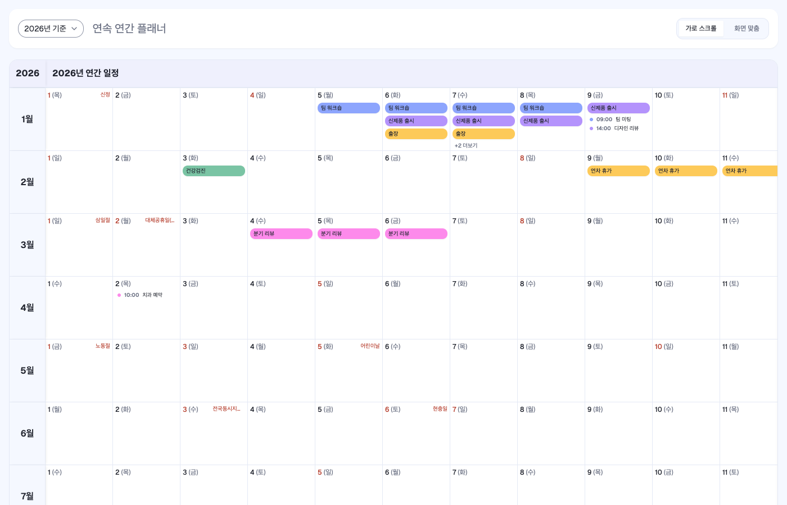
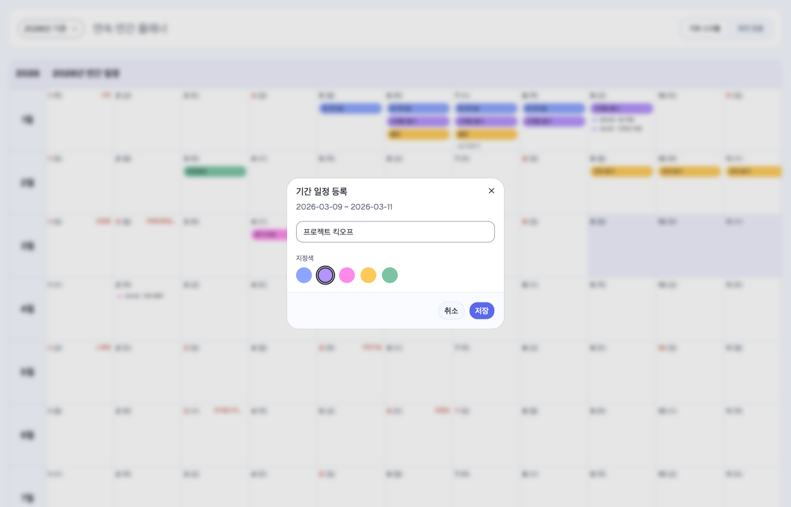
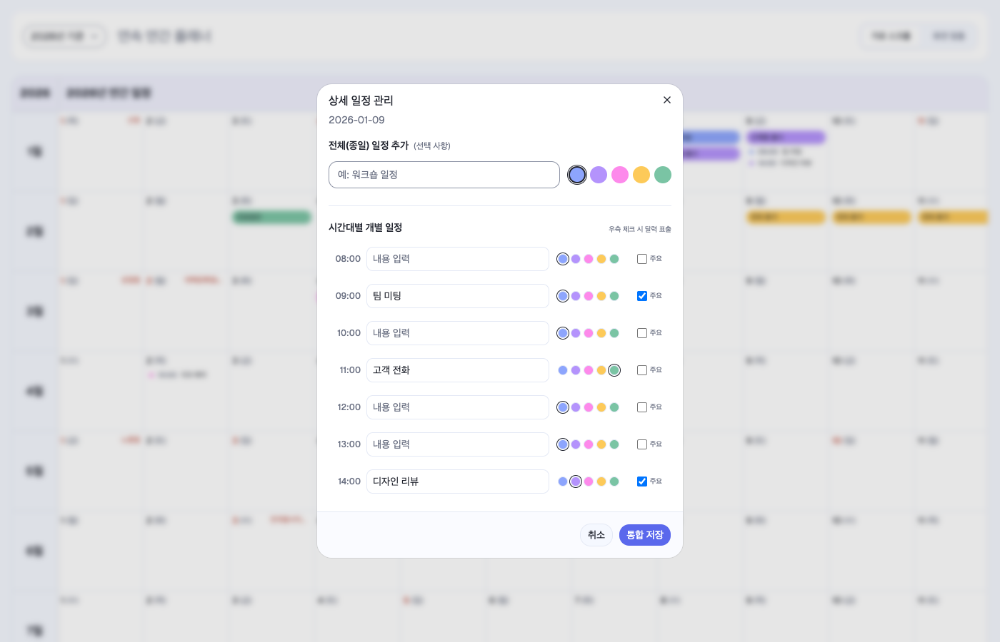
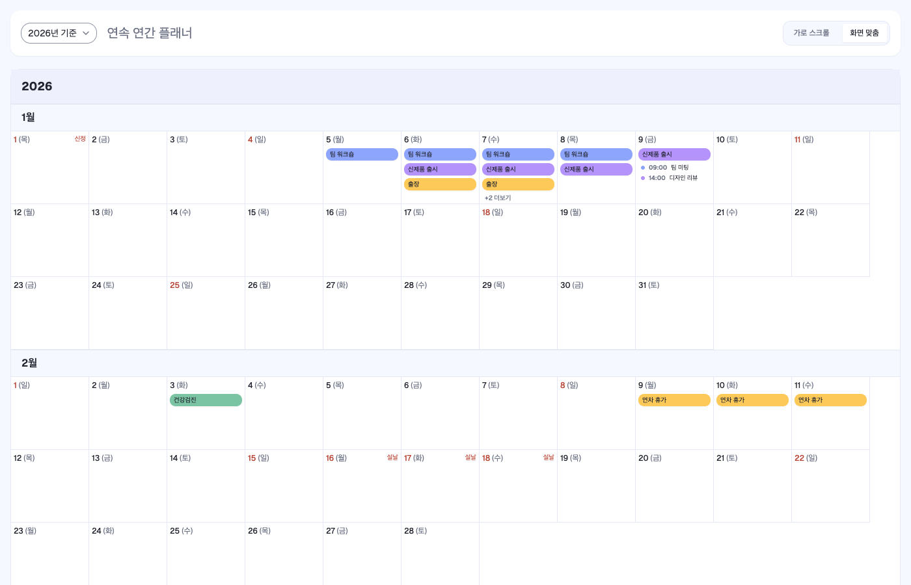

# my-planner

한 화면에서 두 해 분량을 이어서 볼 수 있는 **연간 달력형 플래너**입니다.
날짜를 마우스로 끌어 기간 일정을 만들고, 날짜마다 시간대별 일정을 적을 수 있습니다.
서버도 로그인도 없이 브라우저에서만 동작하고, 데이터는 내 브라우저에 저장됩니다.

## 화면



<table>
  <tr>
    <td width="50%"></td>
    <td width="50%"></td>
  </tr>
  <tr>
    <td align="center">날짜를 끌어서 기간 일정 만들기</td>
    <td align="center">하루의 종일·시간대별 일정 적기</td>
  </tr>
  <tr>
    <td colspan="2"></td>
  </tr>
  <tr>
    <td colspan="2" align="center">"화면 맞춤" 보기: 가로 스크롤 없이 화면 폭에 맞춰 줄바꿈</td>
  </tr>
</table>

> 화면 속 일정은 모두 예시입니다. 이 사진들은 `docs/images/`에 있고, 화면 모양을 크게 바꾸면 다시 찍어서 바꿔 주세요.

## 주요 기능

- **연속 연간 달력**: 선택한 연도와 다음 해를 이어서 보여 줍니다. 가로 스크롤 / 화면 맞춤 두 가지 보기 방식이 있습니다.
- **기간 일정**: 날짜 칸을 마우스로 끌었다 놓으면 기간 일정을 만들 수 있습니다. 색은 5가지 중에서 고릅니다.
- **일정 패널**: 날짜 칸(빈 곳이나 날짜)을 누르면 화면 오른쪽에 그날의 일정 패널이 열립니다. 왼쪽 달력은 계속 보이고, 열린 날짜 칸에는 테두리가 생깁니다. `‹ ›`로 전날·다음 날로 넘어갈 수 있습니다.
  - 위쪽 **이 날의 일정**: 그날에 걸친 기간·종일 일정이 모두 보입니다. 기간 일정에는 `1/4–1/8 · 2/5일째`처럼 기간과 며칠째인지가 붙습니다. 여기서 종일 일정을 바로 추가할 수 있습니다.
  - 아래쪽 **시간 일정**: 0~24시를 30분 칸으로 나눈 시간표입니다. 빈 칸을 **위아래로 끌면** 30분 단위로 카드가 생기고(누르기만 하면 30분), 기존 카드와는 겹치지 않습니다. 시작·끝 시각을 골라 **추가**해도 됩니다. 만든 카드는 가운데를 잡고 끌어 **옮기고**(겹치지만 않으면 다른 카드를 넘어가도 되고, 다른 카드 위에 놓으면 가장 가까운 빈자리로 감), 위·아래 가장자리를 끌어 **길이를 바꿉니다** (이웃 카드에 닿으면 멈춤). 카드를 만들거나 누르면 오른쪽에 **카드 상세 패널**이 열려 이름·시간·색·주요(★)를 고치며, **바로 저장됩니다**. 이름 없이 닫은 카드는 사라집니다.
- **더보기**: 한 칸에 일정이 4개 이상이면 `+N 더보기`가 나타나고, 누르면 일정 패널이 열려 그날의 모든 일정을 봅니다. 칸이 넘칠 때는 ★ 일정을 먼저 보여 줍니다.
- **수정·삭제**: 달력의 기간 일정 막대나 패널의 "이 날의 일정" 띠를 누르면 오른쪽에 **기간 일정 패널**이 열려 이름·기간·색·할 일을 고치며 바로 저장됩니다. 삭제는 패널의 "이 기간 일정 삭제" → 확인. 달력의 시간 일정을 누르면 일정 패널과 그 카드의 상세 패널이 함께 열립니다.
- **공휴일 표시**: 공휴일과 일요일은 날짜가 붉게, 공휴일은 이름도 함께 표시됩니다. 한국천문연구원 공식 자료(2025~2028년)를 씁니다. (아래 [알려진 한계](#알려진-한계) 참고)

## 실행 방법

필요한 것: [Node.js](https://nodejs.org) **20.19 이상** 또는 **22.12 이상** (Vite 8의 요구 사항입니다).
자동 시험(`npm test`)까지 돌리려면 **22.22.2 이상** 또는 **24.15 이상**이 필요합니다 (시험용 도구 jsdom의 요구 사항입니다).

```bash
npm install        # 처음 한 번: 필요한 도구 설치
npm run dev        # 개발 서버 실행 → 터미널에 나오는 주소(보통 http://localhost:5173)를 브라우저로 열기
```

| 명령 | 하는 일 |
|---|---|
| `npm run dev` | 개발 서버를 켭니다. 터미널에서 `Ctrl + C`를 누르면 꺼집니다. |
| `npm run build` | 배포용 파일을 `dist/` 폴더에 만듭니다. |
| `npm run preview` | `build`로 만든 결과를 미리 봅니다. |
| `npm run lint` | 코드 검사기를 돌립니다. 오류가 없어야 정상입니다. |
| `npm test` | 자동 시험을 한 번 돌립니다. 모두 통과해야 정상입니다. (약 30초) |
| `npm run test:watch` | 파일을 저장할 때마다 관련 시험을 다시 돌립니다. 개발 중에 켜 둘 때 편합니다. |
| `npm run sync-holidays` | 공휴일을 공식 API에서 받아 `src/data/holidays.generated.json`에 저장합니다. 공공데이터포털 **인증키(`.env`)가 필요합니다.** `-- --dry-run`을 붙이면 저장하지 않고 바뀔 내용만 봅니다. 설명: [docs/holiday-data.md](docs/holiday-data.md) |

> 개발 서버를 끄면 브라우저에서 `localhost:5173`이 "연결할 수 없음"으로 나옵니다. 앱이 고장 난 것이 아니니 `npm run dev`를 다시 실행하면 됩니다. 저장한 일정은 브라우저에 남아 있습니다.

## 사용 방법

| 하고 싶은 일 | 방법 |
|---|---|
| 연도 바꾸기 | 맨 위 상단 바의 ‹ › 또는 "2026년 ⌄" 연도 선택 (올해 기준 −1년 ~ +3년, 처음에는 올해로 시작). **오늘**을 누르면 올해로 돌아가 오늘 칸을 보여 줌 |
| 보기 방식 바꾸기 | 달력 바로 위 오른쪽의 `가로 스크롤` / `화면 맞춤` 탭 |
| 기간 일정 만들기 | 시작 날짜에서 마우스를 누른 채 끝 날짜까지 끌었다 놓기 → 이름과 색 입력 → 저장 |
| 하루 일정 만들기 | 날짜 칸의 빈 곳(또는 날짜 숫자)을 클릭 → 오른쪽 패널의 "종일 일정명"에 입력 → `종일 일정 추가`(또는 `Enter`). 키보드는 `Tab`으로 날짜에 가서 `Enter` |
| 시간 일정 만들기 | 같은 패널 아래쪽 30분 시간표의 빈 칸을 끌기(또는 시작·끝 시각 고르고 추가) → 오른쪽 카드 상세 패널에서 이름 입력. 바로 저장되고 달력 칸에 보이며, **"주요"에 체크하면 ★가 붙습니다.** |
| 기간 일정 수정 / 삭제 | 달력의 일정 막대나 패널 목록의 띠를 클릭 → 오른쪽 기간 일정 패널에서 고치면 바로 저장, 삭제는 확인 팝업을 거침. 할 일도 적을 수 있음 |
| 시간 일정 수정·삭제 | 시간표에서 카드를 끌어 옮기기·가장자리를 끌어 길이 바꾸기. 카드나 달력의 시간 일정을 클릭 → 카드 상세 패널에서 이름·시간·색을 고치면 바로 저장, "이 시간 일정 삭제"로 지우기 |
| 한 칸의 일정 모두 보기 | 칸을 클릭하거나 칸 아래쪽 `+N 더보기` 클릭 → 오른쪽 패널 |

## 폴더 구조

화면 부품, 데이터 규칙, 설정값이 서로 섞이지 않게 역할별로 나눠 두었습니다.

```
src/
├── main.jsx                   앱의 시작점
├── App.jsx                    상태를 연결하고 화면을 조립하는 곳 (약 180줄)
├── components/                화면 부품
│   ├── layout/Header.jsx          맨 위 상단 바: 흰 캡슐 안의 ‹ 연도 선택 › · 오늘 + "연간 플래너" 부제목
│   ├── calendar/                  달력 표: YearSection(한 해) → MonthRow(한 달) → DayCell(하루), 보기 방식 버튼(ViewModeToggle)
│   ├── panels/DayPanel.jsx        오른쪽 일정 패널: 이 날의 일정(기간·종일) + 종일 추가 + 시간 일정
│   ├── panels/TimeGrid.jsx        30분 칸 시간표 (끌어서 카드 만들기·옮기기·길이 바꾸기, 겹침 없음)
│   ├── panels/BlockPanel.jsx      그 오른쪽의 시간 카드 상세 패널 (이름·시간·색·주요·할 일·삭제)
│   ├── panels/EventPanel.jsx      그 오른쪽의 기간 일정 상세 패널 (이름·기간·색·할 일·삭제)
│   ├── panels/TodoList.jsx        두 상세 패널이 함께 쓰는 할 일 칸
│   ├── modals/                    팝업: 기간 등록 / 삭제 확인
│   ├── common/                    공통 부품: PopupDialog (모든 팝업의 shadcn Dialog 한 겹) · ColorPicker
│   ├── ui/                        shadcn이 만들어 준 부품: button · dialog · select · tabs · popover
│   └── icons/                     X(삭제), ★ 아이콘
├── hooks/
│   ├── usePlannerData.js      일정 데이터를 들고 추가·수정·삭제·저장을 맡음
│   └── useDragSelect.js       날짜를 끌어서 범위를 고르는 동작
├── utils/
│   ├── storage.js             브라우저 저장소 읽기·쓰기 (깨진 데이터에도 앱이 멈추지 않음)
│   ├── date.js                날짜 계산 (한 달의 일수, 요일, 올해, 연도 목록, 날짜 넘기기·며칠째)
│   ├── timeBlocks.js          시간 일정 카드(시작~끝) 다루기: 옛 "몇 시 칸" 데이터 변환, 30분 칸 번호 ↔ 시각, 겹침 검사, 옮기기·늘이기 범위 계산
│   └── color.js               일정 색 위에 올릴 읽기 쉬운 글자색 고르기
├── lib/utils.js               cn(): 여러 클래스 이름을 합치고 충돌을 정리하는 도우미 (shadcn)
├── constants/                 일정 색 팔레트, 바탕 단계 색(파랑 1~5단계), 요일 이름, 연도 선택 범위
├── data/                      공휴일: holidays.generated.json(공식 API에서 받아 온 원본) + holidays.js(앱이 읽는 곳, 표시 이름 보정)
├── index.css                  Tailwind 4 설정 + shadcn 기본 테마(색·모서리 변수)
├── shadcn.css                 shadcn 부품이 쓰는 Tailwind 규칙 (shadcn 패키지에서 복사해 온 파일)
└── test/                      시험 공통 설정(setup.js)과 도우미(helpers.jsx)

docs/                          문서(design-tokens.md 색·디자인 규정, holiday-data.md 공휴일 갱신 방법)와 README 스크린샷(images/)
scripts/                       공휴일 동기화 도구와 그 시험
```

`scripts/`는 앱이 아니라 내 컴퓨터에서 돌리는 도구 스크립트(공휴일 동기화)이고, 앱 배포물에는 들어가지 않습니다. `.env.example`은 인증키를 적는 `.env` 파일의 견본입니다. (진짜 `.env`는 git에 올라가지 않습니다)

프로젝트 맨 위의 `components.json`은 shadcn 설정(스타일 `base-nova`, JavaScript, 기준 색 `neutral`)이고, `jsconfig.json`은 `@/`가 `src/` 폴더를 가리키게 하는 경로 별칭입니다.

시험 파일(`*.test.js`, `*.test.jsx`)은 시험하는 파일 바로 옆에 있습니다. 예를 들어 `utils/storage.js`의 시험은 `utils/storage.test.js`입니다.

원칙: **한 파일은 한 가지 일만 하고**, 팝업과 같은 화면 부품은 데이터를 직접 만지지 않고 `App`이 건네준 값만 보여 주면서 "바뀌었다"고 알립니다.

## 자주 하는 수정

| 바꾸고 싶은 것 | 고칠 파일 |
|---|---|
| 일정 색 추가·변경 | `src/constants/colors.js` |
| 연도 선택 범위 (몇 년 전 ~ 몇 년 뒤) | `src/constants/calendar.js`의 `YEAR_RANGE` |
| 공휴일 갱신 | 직접 고치지 않고 `npm run sync-holidays` ([설명](docs/holiday-data.md)). 화면에 보일 이름만 바꾸려면 `src/data/holidays.js`의 `NAME_OVERRIDES` |
| 일정 저장 방식 (예: 서버로 옮기기) | `src/utils/storage.js`, `src/hooks/usePlannerData.js` |
| 팝업 모양·문구 | `src/components/modals/` 안의 해당 파일 |
| 날짜 칸 모양 | `src/components/calendar/DayCell.jsx` |

## 자동 시험

`npm test`로 아래를 자동으로 확인합니다. (Vitest + Testing Library)

| 종류 | 확인하는 것 | 파일 |
|---|---|---|
| 작은 함수 | 날짜 계산(윤년 포함), 연도 목록, 글자색 대비 계산, 저장소 읽기·쓰기(깨진 데이터에도 멈추지 않음, 저장소 이름표가 바뀌지 않음) | `utils/*.test.js`, `lib/utils.test.js` |
| 훅 | 일정 추가·수정·삭제·저장, 모양이 틀린 저장 데이터로 시작, 날짜 끌기 범위 선택 | `hooks/*.test.js` |
| 화면 동작 | 사람이 쓰는 방식 그대로 누르고 끌고 입력해서: 첫 화면, 연도·보기 방식, 일정 만들기, 칸·시간 일정·막대 누르기, 일정 패널(날짜 넘기기·자동 저장), ★ 표시, 더보기, 수정, 삭제, 접근성 이름 | `App.*.test.jsx` |
| 화면 부품 | 팝업(PopupDialog)과 shadcn 부품(button · dialog · select)의 동작 | `components/**/*.test.jsx` |
| 데이터·설정 | 공휴일 데이터(공식 자료 반영, 표시 이름), 일정 색·바탕 단계 색과 디자인 문서·CSS의 일치, Tailwind·shadcn 설정 | `data/`, `constants/`, `index.css.test.js`, `shadcn-config.test.js` |
| 공휴일 동기화 도구 | API 요청과 응답 해석 | `scripts/*.test.js` |
| README | 스크린샷 파일이 실제로 있고 깨지지 않았는지 | `docs/readme-images.test.js` |

- 화면 동작 시험에서 "오늘"은 **2026-06-15로 고정**됩니다. 올해가 바뀌어도 시험 결과가 달라지지 않게 하려는 것입니다.
- 코드를 고친 뒤에는 `npm run lint`와 `npm test`가 모두 통과하는지 확인합니다.

## 데이터 저장

- 일정은 **내 브라우저의 `localStorage`**에 저장됩니다. 키는 `planner_events`(기간·종일 일정)와 `planner_time_blocks`(시작~끝 시각이 있는 시간 일정)입니다. 예전 형식인 `planner_daily`가 있으면 처음 열 때 새 형식으로 자동 변환하고, 옛 데이터는 백업으로 남겨 둡니다.
- 브라우저와 기기마다 따로 저장되어서 **다른 컴퓨터나 다른 브라우저에서는 보이지 않습니다.**
- 브라우저의 사이트 데이터를 지우면 일정도 **사라집니다.** 내보내기·백업 기능은 아직 없습니다.
- 저장된 데이터가 깨져 있으면 앱은 멈추지 않고 일정이 없는 상태로 시작합니다. 이 상태에서 새로 저장하면 깨진 데이터를 덮어씁니다.

## 알려진 한계

- **공휴일은 2025~2028년만 표시됩니다.** 2029년 이후는 공식 API에 아직 없어서 공휴일 이름이 나오지 않습니다. 해마다 6월 말 이후에 `npm run sync-holidays`로 새 연도를 받아 와야 합니다. ([docs/holiday-data.md](docs/holiday-data.md))
- 공휴일 이름은 공식 API가 준 그대로라 길거나 낯설 수 있습니다. (`대체공휴일(삼일절)`, 선거일 등. 긴 이름은 칸에서 잘리고 마우스를 올리면 전체가 보입니다.)
- 날짜 선택은 **마우스 기준**입니다. 터치 화면에서 끌어서 고르는 동작은 지원하지 않습니다.
- 일정명 확인이 일관되지 않습니다. **수정** 팝업에서 이름을 비우고 저장하면 브라우저 기본 경고창(`alert`)이 뜨지만, **새 일정**을 이름 없이 저장하면 아무 안내 없이 저장되지 않고 팝업만 닫힙니다.
- 자동 시험은 **화면 모양**을 확인하지 못합니다. 글자가 칸에서 잘려 보이는지, 팝업이 겹쳐 보이는지 같은 것은 브라우저에서 직접 봐야 합니다. (시험 환경인 jsdom은 화면 배치를 계산하지 않습니다.)
- 일정 추가 함수를 **한 번의 동작 안에서 두 번** 부르면 첫 번째가 사라지는 한계가 있습니다. 지금 앱은 그렇게 쓰지 않아서 드러나지 않으며, 시험에 `todo`로 표시되어 있습니다.
- **키보드로 닿지 않는 곳이 있습니다.** 날짜 칸 안의 일정 막대는 마우스로만 누를 수 있습니다. 키보드로는 날짜 버튼(`Tab` → `Enter`)으로 오른쪽 일정 패널을 열고, 패널의 "이 날의 일정" 띠(버튼)를 눌러 기간 일정 패널을 엽니다.
- **맨 위 스크린샷은 오른쪽 일정 패널과 파랑 바탕 색을 넣기 전 화면입니다.** 상세 일정은 지금은 팝업이 아니라 오른쪽 패널에서 다룹니다. (스크린샷은 화면이 안정되면 다시 찍을 예정)

## 기술 스택

React 19 · Vite 8 · Tailwind CSS 4 · shadcn/ui (base-nova, Base UI) · ESLint · Vitest + Testing Library (시험)

## 개발 규칙

작업 규칙은 [CLAUDE.md](./CLAUDE.md)에 있습니다. 요약하면 이렇습니다.

- 코드를 바꾸기 전에 무엇을 왜 바꾸는지 먼저 설명하고, 한 번에 한 가지만 바꾼 뒤 끝나면 커밋을 제안합니다.
- 커밋 메시지는 한국어로 "무엇을 왜 바꿨는지" 한 줄로 씁니다.
- `git push --force`는 쓰지 않고, `.env` 파일은 커밋하지 않습니다.
